# 🧪 DFT-Insight Agent

### An AI-assisted computational chemistry tool for Gaussian output analysis, conformer comparison and batch cheminformatics insights.

DFT-Insight Agent is a Python-based computational chemistry analysis tool designed to simplify the extraction, processing and interpretation of data from Gaussian computational chemistry output files.

The project combines **automated Gaussian output parsing, thermochemical analysis, conformer ranking, TD-DFT photophysics and UV-Vis spectral analysis, statistical analysis and machine learning techniques within an interactive Streamlit dashboard**. It also exposes its analytical capabilities through a **Model Context Protocol (MCP) server**, allowing compatible AI clients such as Claude Desktop to interact with the analysis tools.

---

## 📌 Table of Contents

- [Project Motivation](#-project-motivation)
- [Project Objectives](#-project-objectives)
- [Key Features](#-key-features)
- [System Architecture](#-system-architecture)
- [Technology Stack](#-technology-stack)
- [Installation and Setup](#-installation-and-setup)
- [Running the Application](#-running-the-application)
- [Using the Application](#-using-the-application)
- [Sample Analysis and Results](#-sample-analysis-and-results)
- [MCP Integration](#-mcp-integration)
- [Project Structure](#-project-structure)
- [Current Limitations](#-current-limitations)
- [Future Improvements](#-future-improvements)
- [Acknowledgements](#-acknowledgements)

---

## 🎯 Project Motivation

Density Functional Theory (DFT) calculations are widely used in computational chemistry to investigate molecular properties, electronic structures and molecular stability.

However, the output generated by quantum chemistry software such as Gaussian can contain extensive numerical information. Extracting relevant properties, comparing multiple calculations and identifying meaningful relationships across a collection of molecular systems can require considerable manual effort.

Some of the challenges addressed by this project include:

- Manually extracting molecular properties from Gaussian output files.
- Comparing the relative stability of different molecular conformers.
- Calculating Boltzmann population distributions.
- Identifying unusual results within a collection of computational calculations.
- Understanding relationships between calculated molecular properties.
- Exploring similarities and differences across a batch of molecular calculations.

DFT-Insight Agent was developed to make these analytical workflows more accessible through automated data extraction, statistical analysis, machine learning and AI-assisted interaction.

The broader goal is to move beyond simply extracting numerical results and provide a platform that helps researchers explore and understand the information generated by computational chemistry calculations.

## 🎯 Project Objectives

The primary objectives of this project are:

1. Automate the extraction of important molecular and thermochemical properties along with TD-DFT   photophysics/UV-Vis analysis from Gaussian output files.
2. Provide an interactive interface for inspecting individual computational chemistry calculations.
3. Simplify conformer comparison using relative Gibbs free energy and Boltzmann population analysis.
4. Apply statistical and machine learning techniques to explore patterns across multiple calculations.
5. Visualise relationships between selected quantum chemical descriptors.
6. Expose analytical functionality through MCP tools for interaction with compatible AI clients.

---

## ✨ Key Features

### 1. Gaussian Output Analysis

Upload an individual Gaussian `.log` or `.out` file to extract important computational chemistry properties.

**Extracted properties include:**

- SCF electronic energy (Hartree).
- Zero-point vibrational energy (ZPE).
- Enthalpy.
- Gibbs free energy.
- HOMO energy.
- LUMO energy.
- HOMO–LUMO energy gap (eV).
- Dipole moment (Debye).
- Vibrational frequencies and imaginary frequency count.

The application also checks Gaussian output files for common calculation failure signatures and provides possible explanations and suggested fixes.

### 2. Batch Conformer Ranking and Comparison

Analyse multiple Gaussian output files to compare conformers based on their calculated Gibbs free energies.

The module performs:

- Relative Gibbs free energy calculation (ΔG).
- Conformer ranking based on relative free energy.
- Boltzmann factor calculation.
- Boltzmann population percentage calculation.
- Interactive relative energy comparison.
- Boltzmann population distribution visualisation.

The default temperature used for Boltzmann analysis is **298.15 K**.

### 3. Batch Cheminformatics and Machine Learning Insights

Process multiple Gaussian calculations together to explore patterns across selected molecular descriptors.

The batch analysis module includes:

**Principal Component Analysis (PCA)**

- Applies feature standardisation before PCA.
- Reduces the selected descriptor space to up to two principal components.
- Calculates explained variance ratios.
- Visualises calculations in a two-dimensional PCA scatter plot.

**K-Means Clustering**

- Groups calculations according to similarities in the selected standardised descriptors.
- Allows the user to select the number of clusters.
- Displays cluster assignments for individual calculations.

**Outlier Detection**

- Uses Z-score analysis to identify unusual descriptor values.
- Applies a threshold of 2.5 for outlier identification.

**Feature Correlation Analysis**

- Calculates correlations between selected quantum chemical descriptors.
- Displays the relationships through an interactive correlation heatmap.

**Descriptors currently used for batch analysis:**

- HOMO–LUMO energy gap.
- Dipole moment.
- Gibbs free energy.
- SCF electronic energy.

Missing descriptor values are imputed using the corresponding feature mean before standardisation and PCA.

### 4. MCP-Based AI Integration

The project includes an MCP server that exposes the computational chemistry analysis functions as tools for compatible AI clients.

Available MCP tools:

| Tool | Function |
|---|---|
| `analyze_gaussian_file` | Analyses an individual Gaussian output file. |
| `analyze_conformer_folder` | Ranks conformers and calculates Boltzmann populations from a folder of Gaussian files. |
| `analyze_batch_cheminformatics` | Performs batch outlier detection, correlation analysis, PCA and K-Means clustering. |

This integration allows an AI client to invoke the underlying analytical functions and retrieve structured results through natural-language interaction.

---

## 🏗️ System Architecture

The project consists of three main components.

1. **Streamlit application (`app.py`)** – Provides the interactive dashboard and visualisation interface.
2. **Core analysis engine (`parser_core.py`)** – Handles Gaussian parsing, property extraction, conformer ranking and machine learning analysis.
3. **MCP server (`mcp_server.py`)** – Exposes the core analytical functions as tools for compatible AI clients.

### Workflow

```text
             Gaussian Output Files
                 (.log / .out)
                       |
                       v
              Streamlit Dashboard
                  (app.py)
                       |
                       v
              Core Analysis Engine
                (parser_core.py)
                       |
          +------------+------------+
          |            |            |
          v            v            v
      Individual    Conformer    Batch ML &
      Analysis      Analysis     Cheminformatics
          |            |            |
          v            v            v
       Molecular    Energy &     PCA, Clustering,
       Properties   Boltzmann    Correlation &
                    Analysis     Outlier Detection
          |            |            |
          +------------+------------+
                       |
                       v
              Results & Visualisation


        Compatible AI Client (e.g. Claude Desktop)
                       |
                       v
                  MCP Server
                (mcp_server.py)
                       |
                       v
              Core Analysis Engine
                (parser_core.py)
```

The dashboard and MCP server provide separate interfaces to the shared analytical code. The MCP server accesses Gaussian files through its configured filesystem paths.

---

## 🛠️ Technology Stack

| Category | Technologies |
|---|---|
| Programming Language | Python |
| User Interface | Streamlit |
| Gaussian Output Parsing | cclib |
| Data Processing | Pandas, NumPy |
| Scientific Computing | SciPy |
| Machine Learning | Scikit-learn |
| Data Visualisation | Plotly |
| AI Tool Integration | Model Context Protocol (MCP) |

---

## ⚙️ Installation and Setup

### Prerequisites

- Python 3.10 or a compatible Python version.
- pip package manager.
- Gaussian `.log` or `.out` output files for analysis.
- A compatible MCP client if you intend to use the AI integration.

### 1. Clone the repository

```bash
git clone <https://github.com/AkshayAbraham/DFT-Insight-Agent>
```

### 2. Navigate to the project directory

```bash
cd DFT-Insight-Agent
```

### 3. Create a virtual environment

```bash
python -m venv venv
```

### 4. Activate the virtual environment

**Windows:**

```bash
venv\Scripts\activate
```

**Linux / macOS:**

```bash
source venv/bin/activate
```

### 5. Install dependencies

```bash
pip install -r requirements.txt
```

---

## 🚀 Running the Application

### Launch the Streamlit dashboard

From the project root directory, run:

```bash
streamlit run app.py
```

The application will open in your default browser.

### Run the MCP server

To start the MCP server:

```bash
python mcp_server.py
```

The server uses the standard input/output (stdio) transport. It is intended to be launched and managed by a compatible MCP client.

---

## 📖 Using the Application

The dashboard provides four main analysis modes.

### 1. Single File Inspector

1. Launch the Streamlit application.
2. Select **Single File Inspector** from the sidebar.
3. Upload a Gaussian `.log` or `.out` file.
4. Review the extracted molecular properties.
5. Examine the vibrational stability status and any detected calculation errors.

### 2. Batch Conformer Ranking and Comparison

1. Select **Batch Conformer Ranking & Comparison**.
2. Upload multiple Gaussian output files.
3. Allow the application to process the uploaded calculations.
4. Examine the conformer ranking table.
5. Explore the relative Gibbs free energy and Boltzmann population visualisations.

### 3. Batch Cheminformatics and ML Insights

1. Select **Batch Cheminformatics & ML Insights**.
2. Upload multiple Gaussian output files.
3. Choose the desired number of K-Means clusters using the sidebar control.
4. Run the analysis.
5. Examine the batch summary and flagged outliers.
6. Explore the PCA scatter plot and correlation heatmap.
7. Review the clustering assignment table.

### 4. TD-DFT UV-Vis & Excited State Inspector
1. Upload a Gaussian log file containing TD-DFT excited-state calculations (td=(...)).
2. Review key photophysical metrics including $\lambda_{\max}$ (nm), maximum oscillator strength ($f$), and total computed states.
3. Simulated UV-Vis Spectrum: Adjust the Gaussian Broadening Width ($\sigma$ in eV) slider to inspect the normalized absorption spectrum across 200–800 nm.
4. Orbital Transitions Breakdown: Examine the state-by-state table detailing dominant molecular orbital transitions (e.g., HOMO → LUMO percentage contributions), transition character classifications ($\pi \to \pi^*$, Charge-Transfer, Rydberg-like), and automated scientific warnings when charge-transfer states are detected.

**Note:** At least two successful Gaussian calculations are required for the batch analysis. The number of successful calculations must also be sufficient for the selected number of clusters.

---

## 📊 Sample Analysis and Results

### Individual Gaussian Analysis

The application extracts molecular and thermochemical properties from the uploaded Gaussian output file.

**Example properties displayed:**

| Property | Description |
|---|---|
| SCF Energy | Calculated self-consistent field electronic energy |
| HOMO–LUMO Gap | Energy difference between HOMO and LUMO |
| Dipole Moment | Magnitude of the molecular dipole moment |
| Imaginary Frequencies | Number of negative vibrational frequencies |
| Gibbs Free Energy | Calculated Gibbs free energy |

### Conformer Comparison

The conformer ranking module compares different conformations based on their relative Gibbs free energies.

The analysis provides:

- Relative Gibbs free energy (ΔG).
- Boltzmann factors.
- Estimated Boltzmann population percentages.
- Ranked conformer comparison.

### PCA and Batch Analysis

PCA is performed on the selected standardised quantum chemical descriptors.

The explained variance of the first two principal components is used to assess how much of the variation in the selected descriptor dataset is represented in the two-dimensional PCA projection.

The combined explained variance is calculated as:

```text
Combined variance (%) =
(PC1 explained variance + PC2 explained variance) × 100
```

The PCA scatter plot provides a visual representation of the calculations in the reduced descriptor space. Points with similar positions have more similar projections across the selected descriptors, while cluster colours represent K-Means assignments.

The correlation heatmap helps explore relationships between the selected molecular properties, while outlier detection highlights calculations with unusually large Z-scores.

### TD-DFT UV-Vis and Excited State Analysis

For calculations containing time-dependent density functional theory (`TD-DFT`) output, the photophysics module extracts electronic excitation energies and oscillator strengths to model optical behavior[cite: 8, 13].

**Key outputs displayed:**

| Property / Feature | Description |
|---|---|
| $\lambda_{\max}$ (Absorption Peak) | Wavelength (in nm) corresponding to the strongest allowed electronic transition in the optical range ($\ge 150\text{ nm}$)[cite: 8, 13] |
| Max Oscillator Strength ($f$) | Dimensionless intensity of the dominant electronic transition[cite: 8, 13] |
| Simulated UV-Vis Spectrum | Continuous absorption curve (200–800 nm) generated via Gaussian broadening with adjustable bandwidth ($\sigma$ in eV)[cite: 8, 13] |
| Orbital Transition Breakdown | Dominant molecular orbital excitations (e.g., $\text{HOMO} \to \text{LUMO}$) with percentage contributions ($\ge 5\%$)[cite: 8, 12] |
| Transition Character & CT Check | Classifies states (valence $\pi \to \pi^*$, Rydberg-like, or charge-transfer) and flags long-range charge-transfer states that may be underestimated by standard hybrid functionals[cite: 8, 12] |

### Automated Error Diagnostics and Quality Control

When evaluating incomplete or failed Gaussian jobs, the diagnostic engine inspects the calculation footer and excited-state metadata to identify common computational bottlenecks[cite: 10, 14]:

- **Failure Root-Cause Detection:** Automatically flags SCF convergence failures, geometry optimization step limits, internal coordinate issues (`FormBX`), and memory/disk terminations (`Lnk1e`), pairing each with a suggested Gaussian route fix[cite: 8, 10].
- **TD-DFT Validation Checks:** Verifies whether sufficient excited states were computed to cover the visible optical region and checks batch series for consistent state counts across molecules[cite: 14].

### Live Streamlit App: 
**[https://dft-insight-agent-mjade563h4ugrcsytf8ptk.streamlit.app/](https://dft-insight-agent-mjade563h4ugrcsytf8ptk.streamlit.app/)**

### Application Screenshots

**Dashboard**

The sample calculations, screenshots, and exported tables shown below are generated from Gaussian log/output files in the `sample_logs/` directory inside this project[cite: 2, 4, 8].

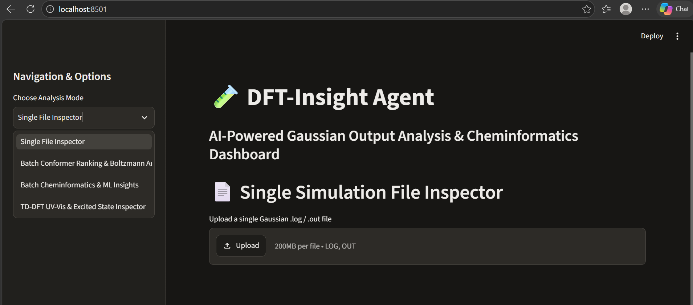

**Single File Analysis**


**Conformer Ranking**

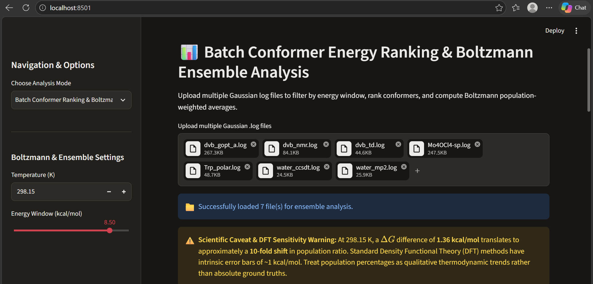
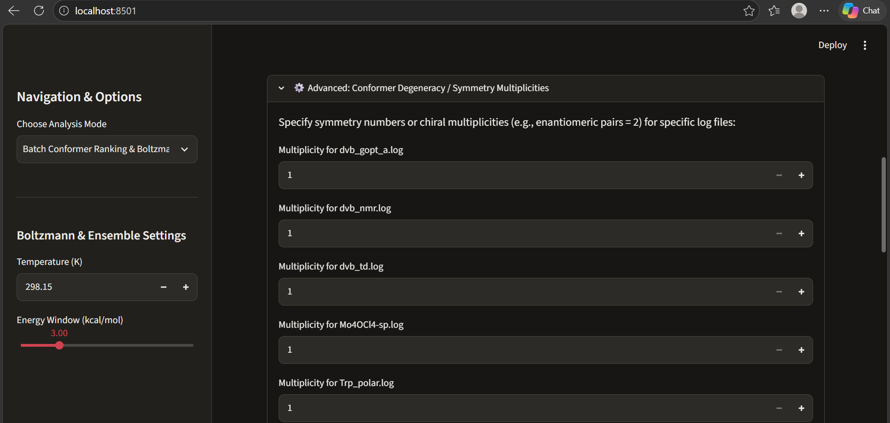


**Batch PCA and Machine Learning Analysis**

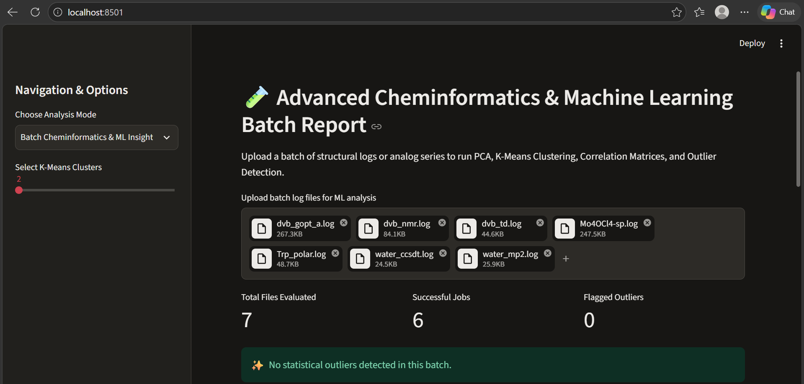
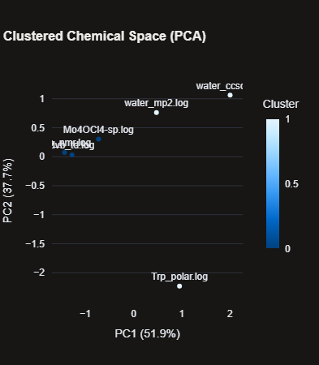
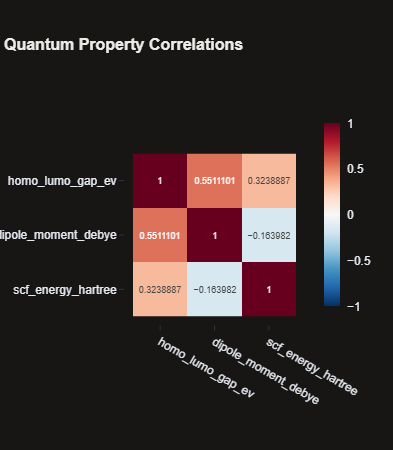


**TD-DFT Analysis**

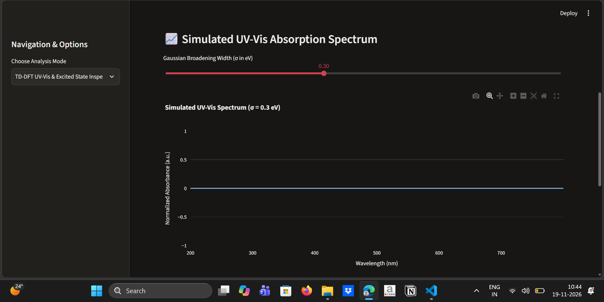


---

## 🤖 MCP Integration

DFT-Insight Agent exposes its analytical functions through an MCP server.

The MCP server can be connected to compatible clients such as Claude Desktop.

The server exposes three tools:

- `analyze_gaussian_file`
- `analyze_conformer_folder`
- `analyze_batch_cheminformatics`

These tools allow an AI client to request analysis of Gaussian files and retrieve structured computational results.

**Important:** The MCP server and the client must be able to access the same Gaussian output files. When the dashboard and MCP server run in separate environments, a shared directory or another suitable file-transfer mechanism must be configured.

Refer to your MCP client's documentation for its server configuration instructions.

### AI Agent & MCP Worker Interaction

The screenshots below demonstrate querying the MCP server tools directly from the workspace assistant using the files in `sample_logs/`[cite: 2, 5]:

| image 1 | image 2 |
| :---: | :---: |
| 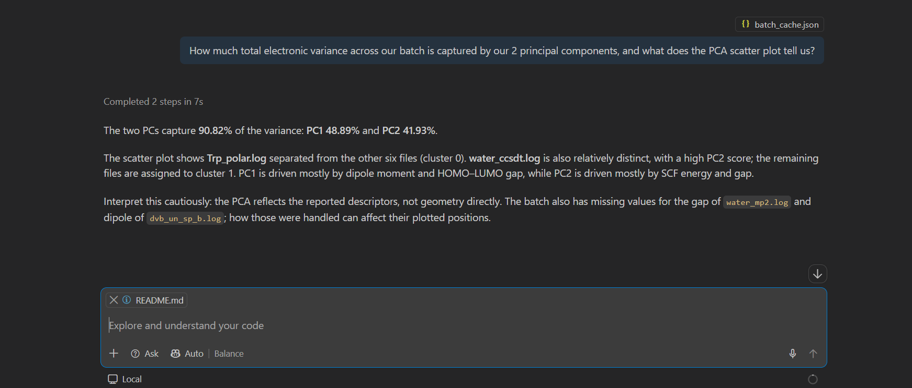 | 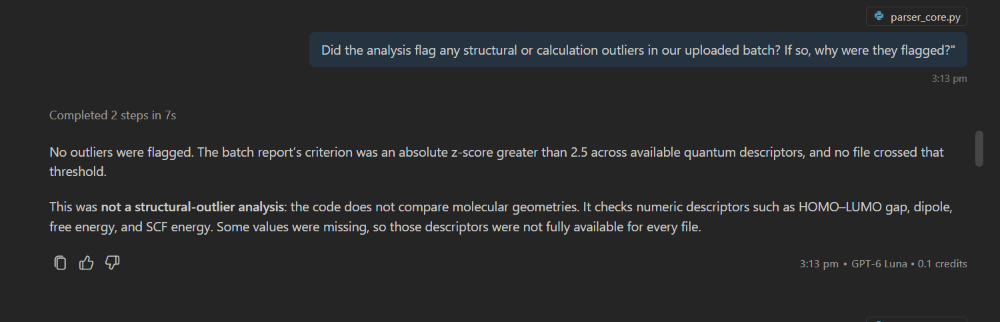 |
| *Caption for screenshot 1* | *Caption for screenshot 2* |

| image 3 | image 4 |
| :---: | :---: |
| 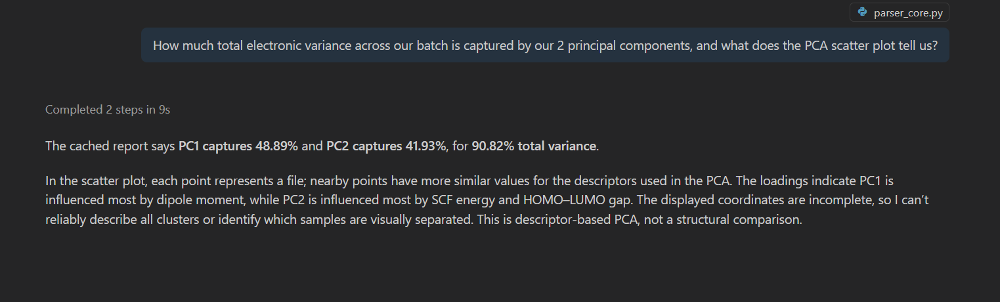 | 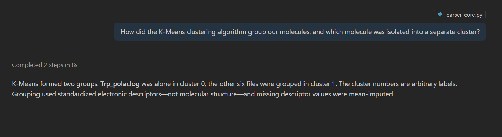 |
| *Caption for screenshot 3* | *Caption for screenshot 4* |

| image 5 | image 6 |
| :---: | :---: |
| 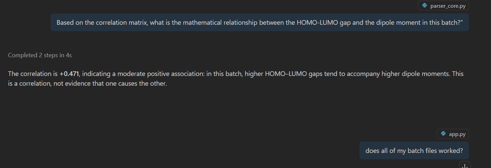 | 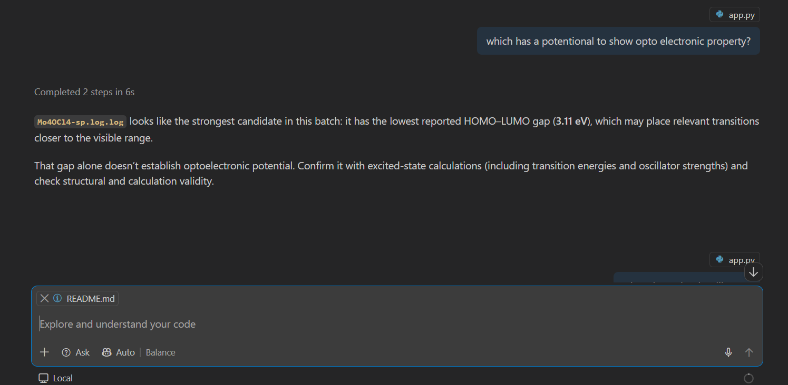 |
| *Caption for screenshot 5* | *Caption for screenshot 6* |

---

## 📁 Project Structure

```text
DFT-Insight-Agent/
│
├── app.py                 # Streamlit application and dashboard[cite: 8]
│
├── parser_core.py         # Core Gaussian parsing and analytical engine[cite: 10]
│
├── boltzmann_core.py      # Conformer Boltzmann ensemble and temperature scan logic[cite: 9]
│
├── tdft/
│   ├── __init__.py        # Package exports for UV-Vis and transition helpers[cite: 11]
│   ├── uv_vis.py          # TD-DFT UV-Vis data parsing and spectrum broadening[cite: 13]
│   ├── transitions.py     # Molecular orbital transition analysis and CT checks[cite: 12]
│   └── validation.py      # TD-DFT quality control and batch consistency checks[cite: 14]
│
├── mcp_server.py          # MCP server and tool definitions[cite: 2, 5]
│
├── test_run.py            # Local analysis and testing script[cite: 4, 7]
│
├── requirements.txt       # Python dependencies (if included)
│
├── sample_logs/           # Gaussian output files[cite: 2, 4, 8]
│
├── assets/
│   ├── screenshots/       # Application and AI worker screenshots
│   └── tables/            # Exported sample CSV tables
│
└── README.md              # Project documentation
```

---

## ⚠️ Current Limitations

- The current implementation focuses on Gaussian `.log` and `.out` output files.
- The batch machine learning module uses a limited set of four quantum chemical descriptors.
- PCA results represent variance across the selected standardised descriptors, not the complete electronic structure or total electronic variance of a molecular system.
- Missing descriptor values are replaced with feature means, which may influence statistical results.
- Outlier detection uses a fixed Z-score threshold of 2.5.
- K-Means clustering results depend on the input dataset and selected cluster count.
- Gaussian error diagnosis is based on a predefined set of recognised error signatures.
- The MCP server requires access to the Gaussian files through its own filesystem environment.
- AI-generated interpretations should be validated against the underlying computational results.

---

## 🔭 Future Improvements

Potential directions for extending the project include:

- Supporting output files from additional quantum chemistry software.
- Expanding the collection of molecular and electronic descriptors.
- Adding molecular structure visualisation.
- Introducing more advanced clustering and anomaly detection approaches.
- Providing batch report export and persistent dataset management.
- Adding PCA feature loadings to improve component interpretation.
- Enhancing AI-assisted interpretation with access to more detailed analytical context.
- Improving the integration between the dashboard, MCP server and shared batch datasets.

---

> **⚠️ Prototype & Mixed-Dataset Notice:** This project is currently at a prototype stage and has been tested on a mixed set of different molecules with limited log files containing thermochemistry and TD-DFT outputs[cite: 8, 9, 10, 13]. Because some calculations have missing properties or heterogeneous job types, certain results or comparisons may be incomplete or inaccurate. Further validation and fine-tuning are planned using a larger, well-curated dataset.

---

## 📚 References & Acknowledgments

### Libraries, Sample Data & Tools
- **cclib:** Python library for parsing and interpreting computational chemistry output files, as well as sample log files used during testing (`cclib` repository / sample outputs)[cite: 3, 10, 13].
- **Scientific Python Stack:** `numpy`, `pandas`, `scipy`, and `scikit-learn` for numerical calculations, data handling, statistical tests, PCA, and clustering[cite: 3, 10].
- **Streamlit & Model Context Protocol (MCP):** Used for building the interactive dashboard and exposing analysis tools to compatible clients[cite: 2, 8].

### AI Assistants Used
- **ChatGPT, Gemini, and Claude:** Used as AI coding and brainstorming assistants during development, debugging, and documentation drafting. (AI-generated suggestions were reviewed alongside project testing and should be verified against primary computational chemistry literature and raw output files[cite: 8, 9, 10, 12].)

## 📄 Licence

This project is available under the MIT licence.

---

**DFT-Insight Agent – Making computational chemistry analysis more accessible through automation, data science and AI-assisted tools.**